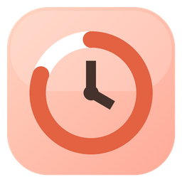
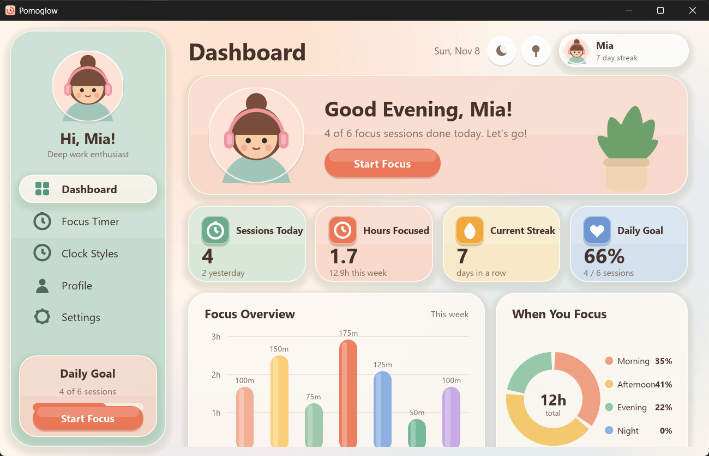
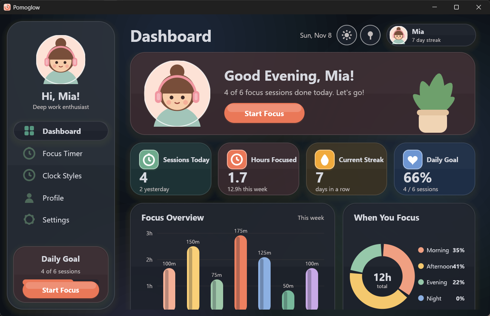
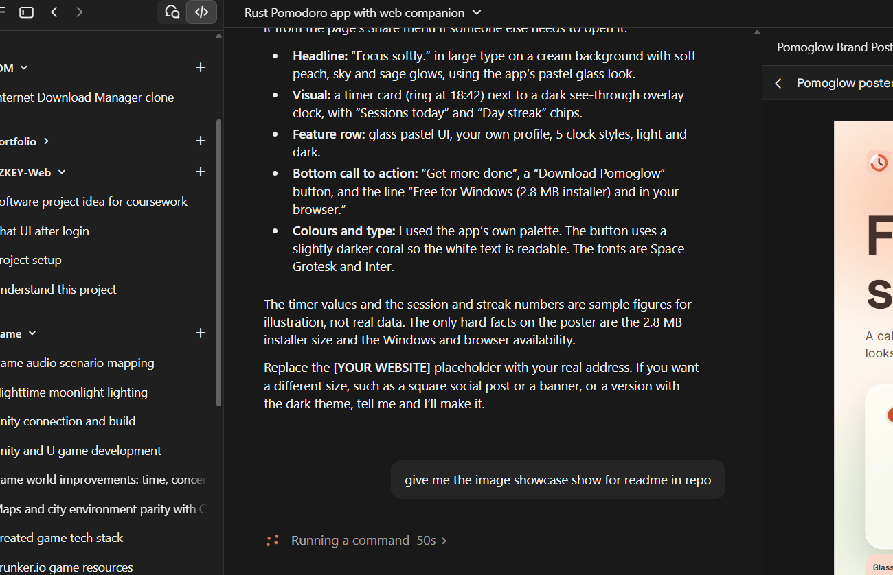
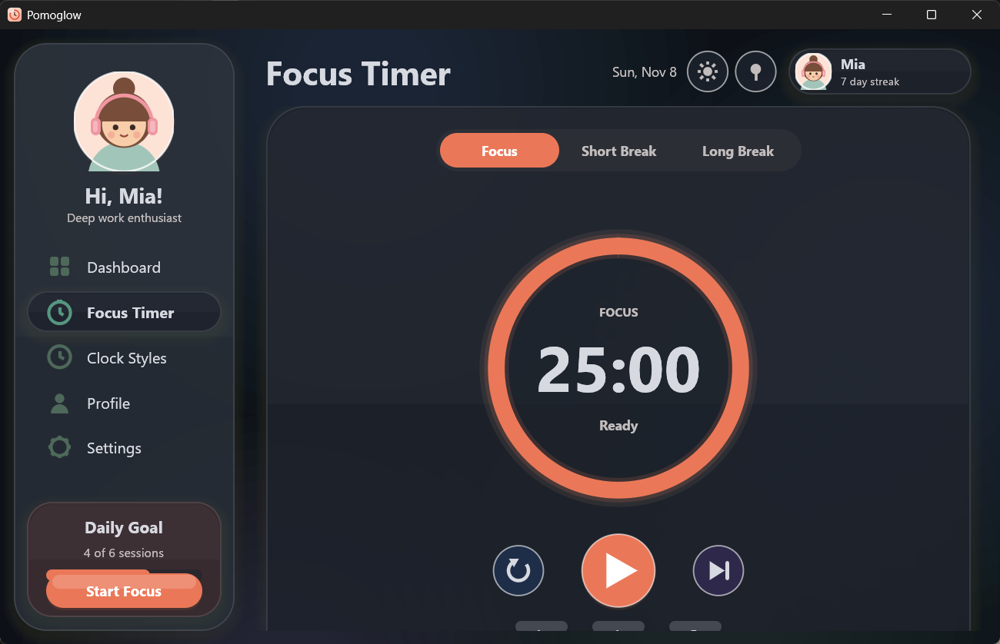
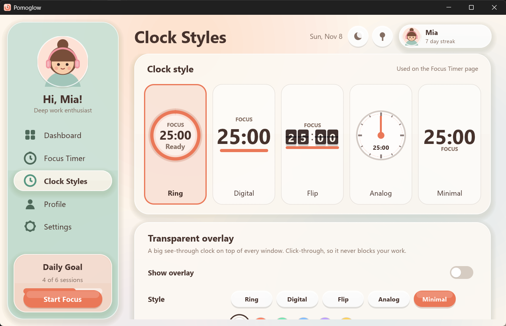
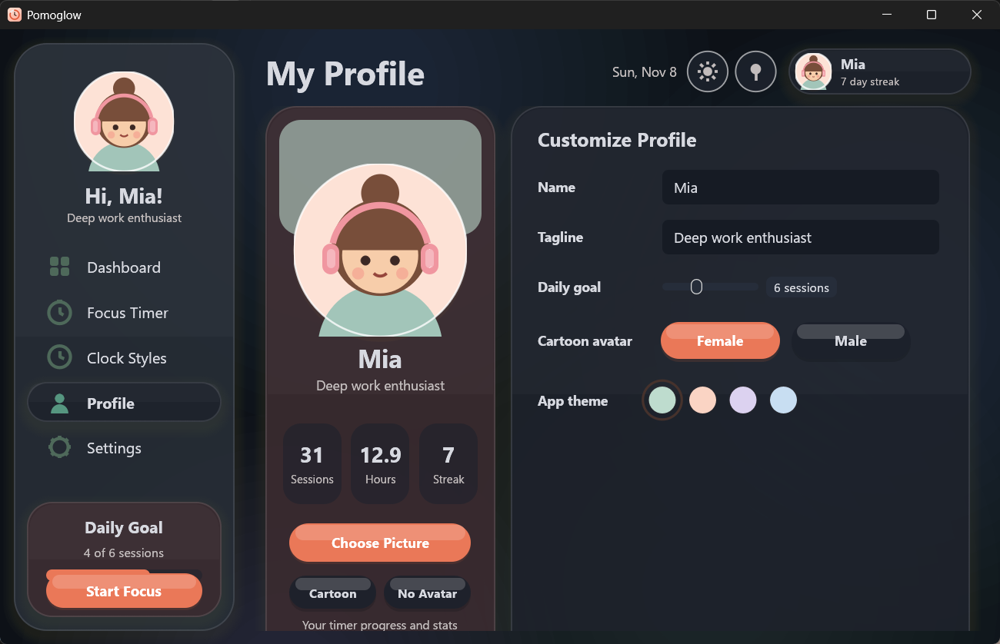
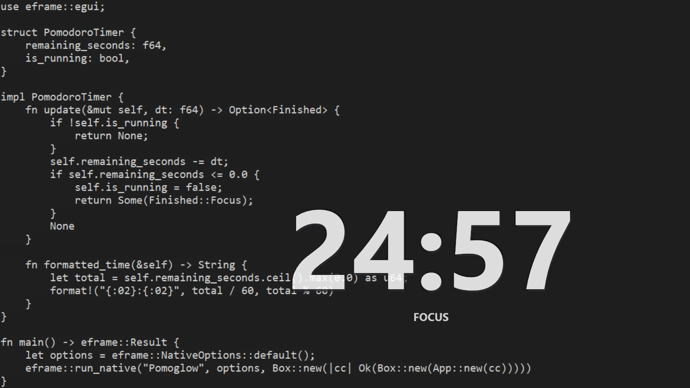
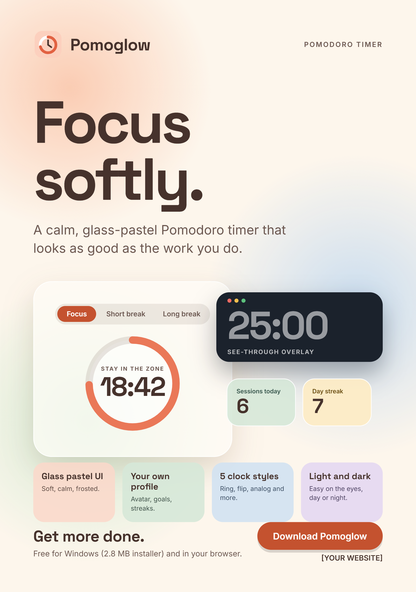

<div align="center">



# Pomoglow

**Focus softly. Get more done.**

A pastel glass Pomodoro timer for Windows with a profile that is truly yours.
Native, tiny and fast: written in Rust.

[](https://github.com/NithijaKalpaSri/PomoGlow/releases/tag/v0.2.0)
[](https://github.com/NithijaKalpaSri/PomoGlow/releases/latest)
[](LICENSE)



</div>

## Download

**[Download the latest installer (Pomoglow-Setup.exe)](https://github.com/NithijaKalpaSri/PomoGlow/releases/latest)**
&nbsp;|&nbsp;
[v0.2.0 release page](https://github.com/NithijaKalpaSri/PomoGlow/releases/tag/v0.2.0)

1. Download **`Pomoglow-Setup.exe`** from the release's **Assets** section.
2. Run it. It installs for your user account only, so no administrator rights are needed. It adds a Start Menu entry, an optional desktop shortcut and an uninstaller in Windows "Installed apps".
3. Silent install: `Pomoglow-Setup.exe /S`

Windows 10 / 11, 64-bit. The installer is about 2.8 MB. Windows SmartScreen may warn about an unsigned download the first time; choose "More info" then "Run anyway".

Your profile and stats are stored in `%APPDATA%\Pomoglow\data.json`.

## Showcase

| Dashboard (light) | Dashboard (dark) |
| :---: | :---: |
|  |  |

| Focus timer | Focus timer (dark) |
| :---: | :---: |
|  |  |

| Five clock styles + overlay settings | Customizable profile |
| :---: | :---: |
|  |  |

### See-through overlay clock

A big, transparent, click-through clock that floats on top of every window (VS Code, browser, games) without getting in the way.



### Brand poster

<p align="center"></p>

## Features

- **Pastel glass UI** with a formal midnight **dark mode**
- **Pomodoro timer**: focus, short break and long break, +/-1 min and +5 min nudges, a "working on" label, 4-session cycle dots, optional auto-start and a chime when a session ends
- **Dashboard**: sessions today, hours focused, streak, daily goal, weekly focus chart, time-of-day donut and recent sessions
- **Customizable profile**: name, tagline, daily goal, avatar (cartoon female / male, your own picture, or none) and app theme. First launch walks you through setup
- **5 clock styles**: Ring, Digital, Flip, Analog and Minimal
- **Transparent overlay clock**: always on top, click-through, with its own style, color, position (7 presets), size and transparency, plus optional mode label and progress bar
- **System tray**: closing the window hides Pomoglow to the tray; left-click the tray icon to reopen, right-click for Open, Start / Pause, Show / Hide overlay and Quit
- **Always-on-top pin**, countdown in the window title and tray tooltip
- **Tiny**: about 5 MB app, 2.8 MB installer, no runtime needed

## Using the overlay clock

1. Open **Clock Styles** in the sidebar and scroll to **Transparent overlay**.
2. Turn on **Show overlay**.
3. Pick a style, color, position, size and transparency. Click-through is on by default; turn it off to drag the clock, then turn it back on.

The main window must stay running (you can hide it to the tray) because it drives the timer and the overlay.

## Build from source

Requirements: Windows 10/11 and [Rust](https://rustup.rs) (stable). To build the installer you also need Python 3 (used only to compress the exe).

```powershell
# run in debug
cargo run

# optimized app: target\release\pomoglow.exe
cargo build --release

# app + tiny installer: dist\Pomoglow-Setup.exe
./build-installer.ps1
```

## Project structure

```
.
├─ src/
│  ├─ main.rs        # window, fonts, startup
│  ├─ app.rs         # pages, sidebar, overlay window, tray handling
│  ├─ clock.rs       # the five clock styles (shared by timer page and overlay)
│  ├─ kit.rs         # glass cards, icons, avatar, dark-mode palette
│  ├─ timer.rs       # Pomodoro timer logic
│  ├─ store.rs       # profile, settings, stats, saved data
│  ├─ tray.rs        # system tray icon and hide-to-tray
│  └─ sound.rs       # completion chime
├─ installer/        # tiny self-contained installer / uninstaller
├─ assets/           # app icon
├─ docs/             # screenshots and brand poster
└─ build-installer.ps1
```

## Tech

Rust, [egui / eframe](https://github.com/emilk/egui) (glow backend), `tray-icon`, `windows-sys`, `serde`.

## License

This project is licensed under the [MIT License](LICENSE). Copyright (c) 2026 NithijaKalpaSri.
